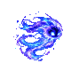

# Gael

**A tiny lightning companion for your Windows gaming desktop.**

Gael is a draggable desktop companion with four glowing energy forms, English chat and speech, and source-linked game guides. Version **0.6.1** adds playful desktop flights that return to the same starting position.



## Features

- Four cyan and violet energy forms: wisp, fox, dragon, and orbital sphere.
- Flowing plasma, orbiting particles, smooth transformations, and idle desktop flights.
- A movable companion with 64, 80, and 96 px sizes, mute, hide, and tray controls.
- English chat and speech, plus optional microphone transcription reviewed before sending.
- Saved game profiles, progress notes, and source-linked help for routes, items, upgrades, and bosses.
- Windows process and Steam game detection, plus League of Legends live-client event alerts.

## Download and run

Once a release is published, open this repository's **Releases** page and download `Gael-0.6.1-Windows-x64.zip` or `Gael-0.6.1-portable.exe`.

1. Extract the ZIP if needed and run `Gael-0.6.1-portable.exe`.
2. Double-click Gael or press **Ctrl+Shift+G** to open the assistant panel.
3. For AI assistance, enter your own OpenAI API key under **Assistant settings**.

No Node.js installation is needed for the portable app. Windows x64 only; the executable is unsigned. Close an older Gael through its tray menu first. Use borderless windowed games; exclusive fullscreen may hide the companion.

## Controls

| Action | Control |
| --- | --- |
| Move | Drag Gael |
| Open assistant | Double-click or Ctrl+Shift+G |
| Local tip | Ctrl+Shift+T |
| Mute or wake | Ctrl+Shift+M |
| Hide or show | Ctrl+Shift+H |
| Settings, transformations, adventures, quit | Right-click or tray menu |
| Start or finish recording | Talk button, or Ctrl+Shift+Space while the panel has focus |

For voice, choose **Talk**, speak, choose **Finish**, review the transcript, then choose **Send**. Recording ends after at most 30 seconds. Speech uses an installed English Windows voice; **Test voice** works without an API key.

## Game guides

Enter the game, platform/version/mode, progress, equipment, and resources. Choose **Save progress**, then **Prepare walkthrough**. Ask focused questions about next steps, routes, upgrades, and bosses. Spoilers are off by default. Update your profile as you advance and check linked sources.

Gael does not read your screen, inventory, or game memory. Map help provides text routes and links. Detection does not automatically update guide progress.

## Privacy and costs

Local tips and animation work without a key. AI chat, guide research, and transcription require your own API key and API credit, and may incur charges. A ChatGPT subscription does not include API credit.

Keys are encrypted with Electron's Windows safeStorage and kept out of the renderer. Relevant game context and submitted questions or recordings are sent to OpenAI when those features are used. Requests specify `store: false`; provider retention policies still apply. Local cancellation does not guarantee processing or billing stops. See [PRIVACY.md](PRIVACY.md).

## Development

Use Windows x64 and Node.js 24 LTS with npm.

```sh
npm ci
npm test
npm start
```

```sh
npm run demo
npm run dist
```

The build creates `dist/Gael-0.6.1-portable.exe`. Package it with `QUICK-START.txt` for the optional ZIP. Upload binaries to GitHub Releases rather than committing them to Git.

GitHub Actions runs automated tests on Windows and offers a manually triggered portable build. Automated checks cover detection, alerts, assistant requests, guides, source links, microphone cleanup, and motion behavior. They do not replace real microphone, paid API, and game compatibility testing.

## Limits

Primary-display movement only. No continuous listening, wake word, screen analysis, interactive game maps, or guaranteed exclusive-fullscreen visibility. Guide quality depends on sources, model, and account access. Interaction, mute, hide, and reduced-motion settings pause or interrupt motion.

## Project resources

- [Quick start](QUICK-START.txt)
- [Changelog](CHANGELOG.md)
- [Contributing](CONTRIBUTING.md)
- [Publishing guide](docs/PUBLISHING.md)
- [English press kit](docs/PRESS-KIT.md)

The energy atlas was generated with ImageGen; see [the asset prompt](assets/IMAGE-PROMPT.txt). No open-source license has been selected yet; public availability alone does not grant permission to reuse the code or artwork.

Gael is independent and is not endorsed by Riot Games. Riot Games and associated properties are trademarks or registered trademarks of Riot Games, Inc.
